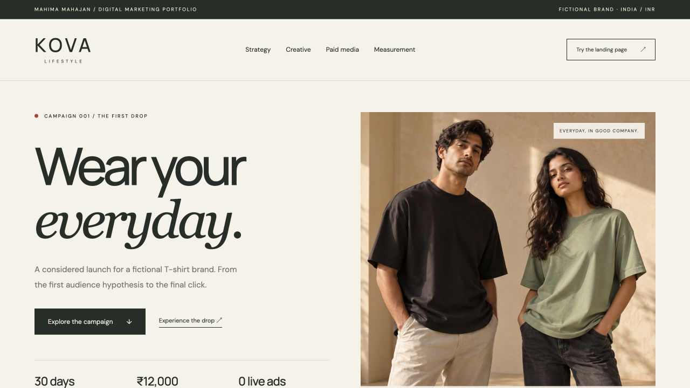

# KOVA Lifestyle — Digital Marketing Launch

A fictional Indian T-shirt launch campaign built for Mahima Mahajan’s digital marketing portfolio. Separate from Kova Operations Studio.

**Campaign:** Wear your everyday.



## Explore

- `dist/index.html`: the marketing case study.
- `dist/drop.html`: a working concept landing page with local test events and a demo signup.
- `dist/journal.html`: the original fit article.
- `dist/emails/`: four rendered email drafts.
- `dist/creatives/`: 11 finished designs in SVG and PNG.
- `dist/downloads/`: campaign brief, calendar, ad assets, keywords, reel scripts and synthetic data.

The project includes 30 content days, 30 keyword ideas, 3 search ad groups, 57 RSA text assets, 15 negative keyword ideas, a Meta creative test plan and a measurement lab. All media plans and budgets are proposals. The synthetic reporting table is not real performance.

## Run locally

No build or installation is needed to view the site. Serve `dist` with a local web server, for example:

```sh
python3 scripts/package.py
python3 scripts/verify.py
python3 -m http.server 5174 --bind 127.0.0.1 --directory dist
```

Open `http://127.0.0.1:5174/`. Use HTTP rather than opening files directly so the landing page and case study share the same local event log.

## Recreate content

`python3 scripts/make-content.py`, `python3 scripts/make-artwork.py` and `python3 scripts/make-emails.py` regenerate the native assets from original inputs. `scripts/export-artwork.mjs` optionally uses Sharp to rasterise the original SVG layouts as PNGs. Set `KOVA_SHARP_MODULE` to a local Sharp module entry when it is not installed in the default module search path. Existing exports are included, so no dependency is required for viewing.

`python3 scripts/package.py` refreshes downloadable packs. `python3 scripts/verify.py` checks content integrity, internal links, ad lengths and basic page metadata.

## Research and evidence

See `dist/downloads/campaign-brief.md` for dated competitor-page observations, sources, decisions, the measurement specification and limits. Sources are primary public pages and official Google documentation. Personas are hypotheses. Keyword volume and product quality are not verified.

## Honest scope

No ads were run, emails sent, posts published or real leads collected. The signup discards the email and only writes a browser-local demonstration event. No tracking provider, payment service or external API is connected. No video is claimed: reels are scripts and storyboards.

ChatGPT and Codex assisted with planning, writing, image concepts, creative layouts, website code and testing. See `content/image-prompts.md` for the original prompts. This project demonstrates AI-assisted marketing work, not independent authorship of every technical element.

## Related project

[Kova Operations Studio](https://github.com/mahima68/kova-operations-studio) covers stock, orders, returns and suppliers for the same fictional brand.

The hosted campaign site remains private. This repository includes the website and assets so reviewers can run them locally. Generated download ZIPs may be omitted from the GitHub copy to avoid storing duplicate archives. Run `python3 scripts/package.py` before the link checks if those ZIPs are absent.
